[](https://github.com/winterstim/tonelab-muse/actions/workflows/ci.yml)



# Tonelab Muse

**Describe a sound. Muse sets it up in your real DAW, listens to the result and fixes it.**

▶ **[Watch the demo](https://youtu.be/3swa0zIRYlM)**

Musicians lose hours turning dozens of knobs across a chain of plugins to get the sound they hear in their head. Muse gives that time back: you say what you want and keep playing.

Tell it "tight modern metal, chug-chug-chug", show it a photo of your pedal, or give it a reference track. Muse plans the signal chain, turns the knobs in your session, reads every value back from the DAW, renders the track, listens, and refines. On a multi-track session it hands each track to its own subagent and then checks the whole mix.

Works with **REAPER** and **Ableton Live** today, and with other DAWs through their remote-control interface. Every model decision is made by Meta's Muse models.

## Quick start

Download the zip for your system from [Releases](https://github.com/winterstim/tonelab-muse/releases), unzip, and run the launcher (`start.command` on macOS, `start.bat` on Windows). Then open `http://127.0.0.1:7400`.

Or build from source (Go 1.26):

Paste your Model API key in Settings (or `export MODEL_API_KEY=...`).

```bash
go build -o tonelab-muse ./cmd/tonelab-muse
export MODEL_API_KEY=...
./tonelab-muse -demo serve      # built-in simulated studio, no DAW needed
./tonelab-muse serve            # with REAPER or Ableton Live open
```

- **REAPER:** Muse enables REAPER's remote control and installs its bridge on first run.
- **Ableton Live:** run `scripts/install-ableton-ext.sh`, then pick Muse as a Control Surface in Live's settings.

Command line: `./tonelab-muse ask "Warm blues crunch"`; put `-ref clip.wav` before `ask` to match a recording, or put `-preview` before `ask` to see the plan without changing anything.

## What it does

- **Words → sound.** A request becomes concrete control changes with targets, e.g. "-3 dB at 400 Hz".
- **Photo → sound.** A photo of a real amp or pedal: Muse finds each knob, reads its position and maps it to your plugins.
- **Reference → sound.** Give it a recording; it closes the gap round by round.
- **Voice.** Push to talk; speech is transcribed with the session's plugin and control names as hints.
- **Listening.** Muse renders the track, measures six bands and reads a labelled spectrogram, then corrects what is off.
- **Whole sessions.** One subagent per track, buses and sends set up by the parent, a final mix check for clashes.
- **Safe by default.** A snapshot before the first change, one-step undo, and three modes: *Review* (plan only), *Default* (apply and listen), *Turbo* (full autopilot).

## How it works

```
request ─▶ plan (Muse Spark) ─▶ apply to DAW ─▶ read back ─▶ render + listen ─▶ refine
                                     │                              ▲
                                     └── subagent per track ────────┘
```

1. **Plan.** The model reads the request, the plugin chain and your taste memory, and proposes changes.
2. **Apply and verify.** Each change is sent to the DAW; the DAW's own readout must confirm it.
3. **Listen.** The track is rendered and measured; the spectrogram goes to the model as an image.
4. **Refine.** The model compares the result with the goal and adjusts, up to three rounds.

If a plugin hides its controls, Muse reads them from the plugin's saved state, falls back to its presets, or gives at most three steps to expose them.

## Reliability

Every operation the agent can perform is tested against the real DAW: write, read back, compare, restore.

| | Pass | Guided | Fail | Total |
|---|---:|---:|---:|---:|
| REAPER | 38 | 3 | 0 | 41 |
| Ableton Live | 38 | 3 | 0 | 41 |

"Guided" operations (MIDI-learn, recording, amp-model switch) are done with the user in a few short steps. Full tables: [docs/conformance](docs/conformance).

Run it yourself: `./tonelab-muse conformance --daw fake|reaper|ableton`.

Token use scales with the job:

| Request | Tokens |
|---|---|
| One track, one request ("warm blues crunch") | ~8k |
| One track with listening and fixes | ~50k |
| Whole session: 3 tracks, a subagent each, reverb bus, sends, mix check | ~110k |

The session figure covers three separate tone jobs plus the mix, with every change read back from the DAW. It is a third of what the first version used for the same job.

## Models

Muse models make every decision: what to change, how it sounds, what to fix next. The code only carries out their plan in the DAW and checks the result. Without the model there is no plan.

| Model | Role |
|---|---|
| Muse Spark 1.3 | Default planner; reads spectrograms and gear photos |
| Muse Wonder 1.0 | Alternative planner |
| Muse Voice Transcribe | Speech input |
| SAM 3.1 | Finds and cuts out each knob in a gear photo |
| Muse Glimmer 30B (open weights) | Self-hosted planner, on your own GPU or a cloud GPU (`deploy/modal`); 12/12 on the tone eval |

Hosted models: 36/36 on the tone eval (12 cases × 3 runs). Run it: `go run ./cmd/eval`.

Privacy: in cloud mode, requests, photos and rendered audio go to the Meta Model API. With open weights, everything stays on your server.

## Code map

- `pkg/core`: domain types, the operation contract and ports.
- `pkg/agent`: the tool loop, subagents, token budget, snapshots, taste memory.
- `pkg/muse`: Meta Model API client, segmentation, voice.
- `pkg/ears`: band measurement and spectrograms, pure Go.
- `internal/daw/reaper`, `internal/daw/oscmap`: DAW adapters; `internal/daw/fake`: simulated studio.
- `internal/conformance`: the live operation checks.
- `internal/oslayer`: project save and plugin windows through the operating system.
- `internal/server`: local web UI.
- `cmd/hands`: macOS helper for DAWs without an export API.

Dependency rules are enforced by `internal/archtest`.

## Author

Built by Tymofii Vodianytskyi, guitarist and developer.

## License

Source available under the [PolyForm Noncommercial License 1.0.0](LICENSE). You may use, study and change it for any noncommercial purpose. Commercial use, including offering it as a paid product or service, needs a separate license from the author.
